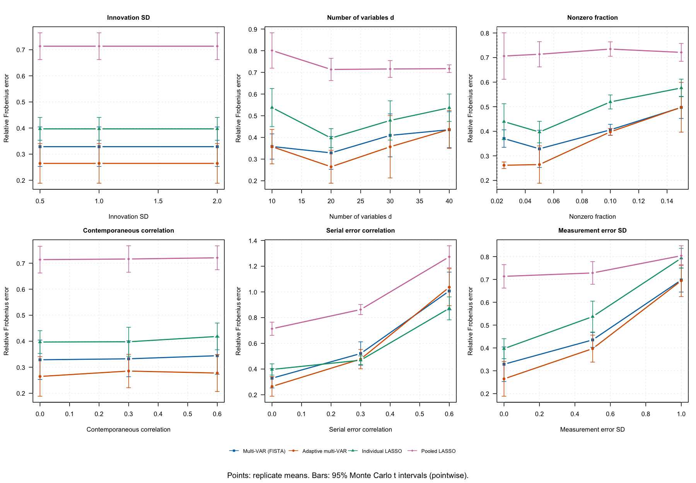
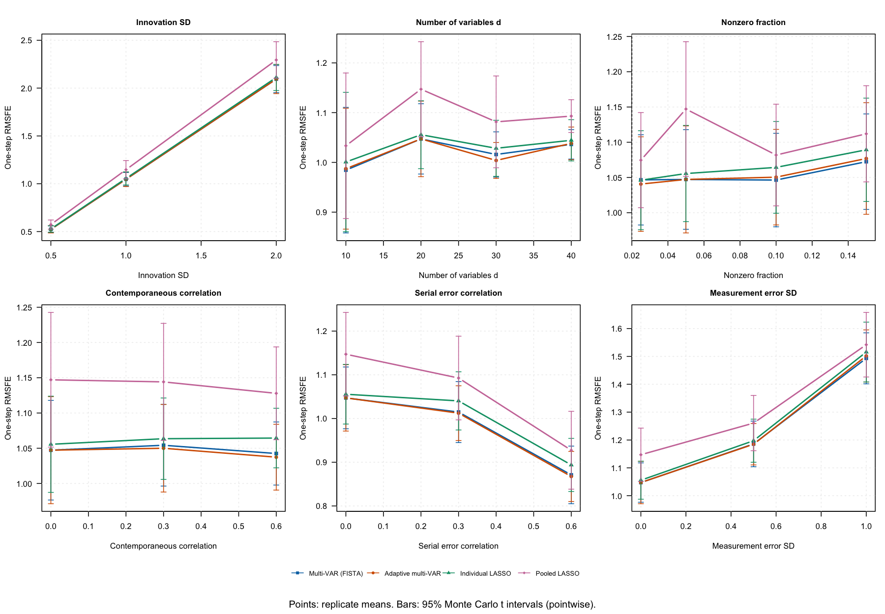
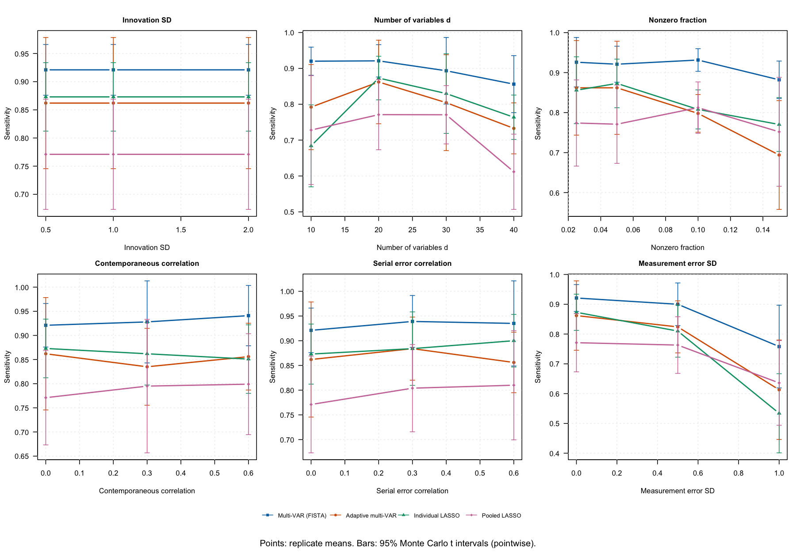
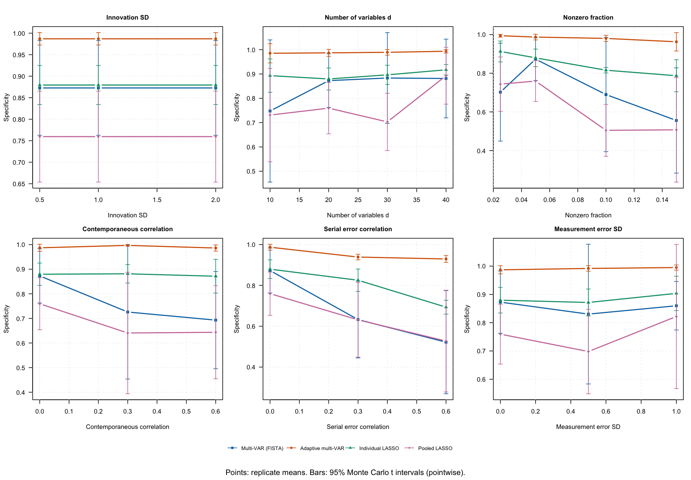

```{r setup, include=FALSE}
knitr::opts_chunk$set(echo = FALSE, message = FALSE, warning = FALSE)
```

# Abstract

Intensive longitudinal studies measure several variables repeatedly for many
individuals, often with too few observations to estimate each person's dynamics
reliably. This project studies the multi-VAR method of Fisher et al. (2022),
which decomposes each person's vector autoregressive coefficients into shared
and individual components. Sparse penalties control model complexity, while
adaptive weights use preliminary estimates to adjust shrinkage. A preliminary
simulation compares standard and adaptive multi-VAR with individual and pooled
LASSO across 16 conditions, with five replications per condition. At baseline,
adaptive multi-VAR has lower coefficient-recovery error than the benchmarks,
although forecasting differences are small. The next stage will run more replications, use more validation time points,and evaluate daily psychological measurements from the FLIP study. The current report documents completed simulations and an initial real dataset inventory;
real-data preprocessing and model fitting remain future work.

# Introduction

Daily diary studies record how a person's emotions, self-perceptions, and
behaviors evolve together. A useful question is whether today's nervousness
or sociability helps predict tomorrow's self-esteem, and whether these
relationships are similar across people. The candidate FLIP dataset contains
daily measurements from 85 participants over an 82-day study period. It offers
a concrete setting for studying both common patterns and individual differences.
The available measurements and planned preparation are described in Future Steps.

A vector autoregressive model predicts each variable from earlier measurements
of all variables. Its flexibility comes at a cost: the number of lagged effects
grows rapidly as variables are added, while a daily diary may provide only a
short series for each participant. Fitting a separate unrestricted model for
everyone can therefore be unstable. Individual LASSO reduces complexity through
sparsity but does not use information from other people. A pooled model shares
all coefficients, which can conceal meaningful differences between participants.

Fisher et al. (2022) propose multi-VAR to estimate individual dynamics jointly.
Each person's model combines a shared component with sparse individual
deviations. Penalization controls both model complexity and the amount of
sharing. An adaptive version changes the strength of individual coefficient
penalties using preliminary estimates, potentially reducing unnecessary
shrinkage of larger effects.

This project asks when such sharing improves coefficient recovery and
forecasting, and how robust those gains are to changes in dimension, sparsity,
series length, and error structure. The completed pilot provides preliminary
answers and identifies limitations to investigate before applying the method
to real data measurements.

\newpage

# Methods

## VAR model and assumptions

For one subject, the $d$-dimensional series
$\{\mathbf X_t\}_{t\in\mathbb Z}$ follows a VAR($p$) process if
\[
\mathbf X_t=\boldsymbol\Phi_1\mathbf X_{t-1}+\cdots+
\boldsymbol\Phi_p\mathbf X_{t-p}+\boldsymbol\varepsilon_t,
\qquad t\in\mathbb Z,
\]
where $\boldsymbol\Phi_1,\ldots,\boldsymbol\Phi_p$ are $d\times d$
transition matrices. The white-noise innovations satisfy
\[
\{\boldsymbol\varepsilon_t\}_{t\in\mathbb Z}
\sim\operatorname{WN}(\mathbf 0,\boldsymbol\Sigma_\varepsilon),\qquad
E(\boldsymbol\varepsilon_t)=\mathbf 0,\qquad
E(\boldsymbol\varepsilon_t\boldsymbol\varepsilon_s')=\mathbf 0
\quad(s\ne t).
\]

For multiple subjects, a superscript $(k)$ identifies subject $k=1,\ldots,K$;
for example, $\boldsymbol\Phi_\ell^{(k)}$ is that subject's lag-$\ell$
transition matrix. Its $(i,j)$ entry describes the predictive association
between variable $j$ at time $t-\ell$ and variable $i$ at time $t$,
conditional on the other lagged variables. At lag one, diagonal entries
represent persistence and off-diagonal entries represent cross-variable
lagged relationships.

## Regression form and vectorized coefficients

Let $T$ be the total number of time points for each subject. Let $N=T-p$ and $q=pd^2$. The regression
matrices for one subject are
\[
\mathcal Y=
\begin{bmatrix}\mathbf X_{p+1}'\\ \vdots\\ \mathbf X_T'\end{bmatrix},
\quad
\mathcal X=
\begin{bmatrix}
\mathbf X_p'&\cdots&\mathbf X_1'\\
\vdots&&\vdots\\
\mathbf X_{T-1}'&\cdots&\mathbf X_{T-p}'
\end{bmatrix},
\quad
\mathcal B^*=
\begin{bmatrix}\boldsymbol\Phi_1'\\ \vdots\\ \boldsymbol\Phi_p'\end{bmatrix}.
\]
Thus $\mathcal Y=\mathcal X\mathcal B^*+\mathcal E$, where
$\mathcal Y,\mathcal E\in\mathbb R^{N\times d}$,
$\mathcal X\in\mathbb R^{N\times pd}$, and
$\mathcal B^*\in\mathbb R^{pd\times d}$. Vectorizing by columns gives
\[
\mathbf Y=\mathbf Z\mathbf B^*+\mathbf E,
\quad
\mathbf Y=\operatorname{vec}(\mathcal Y),\quad
\mathbf Z=\mathbf I_d\otimes\mathcal X,\quad
\mathbf B^*=\operatorname{vec}(\mathcal B^*),\quad
\mathbf E=\operatorname{vec}(\mathcal E).
\]
Here $\mathbf Y,\mathbf E\in\mathbb R^{Nd}$,
$\mathbf Z\in\mathbb R^{Nd\times q}$, and
$\mathbf B^*\in\mathbb R^q$. The star denotes the true coefficient vector;
$\widehat{\mathbf B}$ denotes its estimate. In particular,
$\mathcal B^*$ is a **matrix**, whereas $\mathbf B^*$ is its vectorization.
For VAR(1), $\mathcal B^*=\boldsymbol\Phi_1'$.

Sparsity means that only a small number of the $q$ entries of $\mathbf B^*$
are nonzero. The individual LASSO estimator is
\[
\widehat{\mathbf B}=\underset{\mathbf B\in\mathbb R^q}{\operatorname{argmin}}
\left\{\frac{1}{N}\|\mathbf Y-\mathbf Z\mathbf B\|_2^2
+\lambda\|\mathbf B\|_1\right\}.
\]
For subject $k$, the corresponding data are $\mathbf Y^{(k)}$ and
$\mathbf Z^{(k)}$, and the true coefficient vector is $\mathbf B_k^*$.
Separate LASSO fits reduce complexity but do not share information across
subjects.

## Standard multi-VAR

The defining decomposition is:
\[
\mathbf B_k^*=\boldsymbol\mu^*+\boldsymbol\Delta_k^*,
\qquad k=1,\ldots,K.
\]
Here $\boldsymbol\mu^*\in\mathbb R^q$ contains shared coefficients and
$\boldsymbol\Delta_k^*\in\mathbb R^q$ contains subject-specific deviations.
The standard multi-VAR estimator solves:
\[
(\widehat{\boldsymbol\mu},\widehat{\boldsymbol\Delta}_1,\ldots,
\widehat{\boldsymbol\Delta}_K)
=\underset{\boldsymbol\mu,\boldsymbol\Delta_1,\ldots,\boldsymbol\Delta_K}
{\operatorname{argmin}}
\left\{
\frac{1}{N}\sum_{k=1}^K
\|\mathbf Y^{(k)}-\mathbf Z^{(k)}(\boldsymbol\mu+\boldsymbol\Delta_k)\|_2^2
+\lambda_1\|\boldsymbol\mu\|_1
+\sum_{k=1}^K\lambda_{2,k}\|\boldsymbol\Delta_k\|_1
\right\}.
\]
The penalty $\lambda_1$ shrinks common effects, while $\lambda_{2,k}$
shrinks subject $k$'s deviations. Define $r_k=\lambda_{2,k}/\lambda_1$. Increasing the relative penalty on deviations encourages
more sharing.

The estimated subject coefficients are
$\widehat{\mathbf B}_k=\widehat{\boldsymbol\mu}+
\widehat{\boldsymbol\Delta}_k$. Reshaping this vector into the regression
matrix and transposing its lag blocks recovers
$\widehat{\boldsymbol\Phi}_\ell^{(k)}$.

## Adaptive multi-VAR

The adaptive criterion uses entry-specific penalty
weights. Writing its weighted sums, it minimizes
\[
\frac{1}{N}\sum_{k=1}^K
\|\mathbf Y^{(k)}-\mathbf Z^{(k)}(\boldsymbol\mu+\boldsymbol\Delta_k)\|_2^2
+\lambda_1\sum_{j=1}^q\omega_j|\mu_j|
+\sum_{k=1}^K\lambda_{2,k}\sum_{j=1}^q\nu_{k,j}|\Delta_{k,j}|.
\]
Let $\widetilde{\mathbf B}_k=(\widetilde B_{k,j})_{j=1}^q$ be a
preliminary estimate of the subject coefficient vector. Using the paper's
notation for its coordinatewise median,
\[
\widetilde B_{\ell_j,j}
=\operatorname{median}(\widetilde B_{1,j},\ldots,\widetilde B_{K,j}),
\qquad
\omega_j=\frac{1}{|\widetilde B_{\ell_j,j}|},\qquad
\nu_{k,j}=\frac{1}{|\widetilde B_{k,j}-\widetilde B_{\ell_j,j}|}.
\]
The subscript $\ell_j$ is the median notation. Large preliminary common effects or deviations
receive smaller penalties. Small preliminary values receive stronger
shrinkage. The preliminary estimates use individual OLS when each training design has
full rank, and a fixed-penalty standard multi-VAR
pilot otherwise.

## Penalty control and selection

The squared-error term measures how closely the fitted values follow the
observed series. In individual LASSO, $\lambda\|\mathbf B\|_1$ shrinks a
subject's lag coefficients toward zero and can exclude individual predictors.
Multi-VAR applies this idea to two parts of each coefficient. The common
penalty, $\lambda_1\|\boldsymbol\mu\|_1$, charges once for a shared
coefficient that can improve the fit for many subjects. It shrinks common
coefficients toward zero and can remove weak relationships from the shared
model. The individual penalty, $\lambda_{2,k}\|\boldsymbol\Delta_k\|_1$,
charges for each departure by subject $k$ from the shared coefficient.
It shrinks that subject's estimate toward the shared value.

Adaptive multi-VAR uses pilot estimates to adjust these penalties for each
coefficient. A common coefficient with a large absolute pilot median gets a
smaller weight $\omega_j$, so the final fit shrinks it less heavily. A subject
whose pilot coefficient is close to that median gets a large deviation weight
$\nu_{k,j}$, encouraging their coefficient to equal the shared value. A large
pilot departure receives a smaller deviation weight, giving the final fit
more room to retain an individual difference.

Rolling-window cross-validation selects the penalty settings. For each
candidate setting and forecast origin $t$, the model uses observations
through $t$ to estimate the coefficients and predict the next observation
for subject $k$,
\[
\widehat{\mathbf Y}_{t+1}^{(k)}
=\mathbf Z_t^{(k)}
(\widehat{\boldsymbol\mu}+\widehat{\boldsymbol\Delta}_k).
\]
For multi-VAR, the selected setting minimizes the average squared one-step
forecast error across variables, subjects, and validation windows. The
model is then refitted on the full training period using that setting.

## Optimization

Stack the parameter blocks into
$\boldsymbol\theta=(\boldsymbol\mu',\boldsymbol\Delta_1',\ldots,
\boldsymbol\Delta_K')'$. The augmented regression is
\[
\underbrace{\begin{bmatrix}
\mathbf Y^{(1)}\\\mathbf Y^{(2)}\\\vdots\\\mathbf Y^{(K)}
\end{bmatrix}}_{\mathscr Y}
=
\underbrace{\begin{bmatrix}
\mathbf Z^{(1)}&\mathbf Z^{(1)}&\mathbf 0&\cdots&\mathbf 0\\
\mathbf Z^{(2)}&\mathbf 0&\mathbf Z^{(2)}&\cdots&\mathbf 0\\
\vdots&\vdots&\vdots&\ddots&\vdots\\
\mathbf Z^{(K)}&\mathbf 0&\mathbf 0&\cdots&\mathbf Z^{(K)}
\end{bmatrix}}_{\mathscr X}
\boldsymbol\theta^*+\mathscr E.
\]
The first block is shared; each remaining block contributes only to one
subject. Here $\mathscr X\in\mathbb R^{KNd\times(K+1)q}$ and
$\boldsymbol\theta\in\mathbb R^{(K+1)q}$. For the weighted-LASSO
form, the estimator is
\[
\widehat{\boldsymbol\theta}
=\underset{\boldsymbol\theta}{\operatorname{argmin}}
\left\{\frac{1}{N}\|\mathscr Y-\mathscr X\boldsymbol\theta\|_2^2
+\lambda_1\|\boldsymbol\theta\|_{1,\mathbf w}\right\},
\qquad
\|\boldsymbol\theta\|_{1,\mathbf w}=\sum_i w_i|\theta_i|.
\]
There is one weight for each coefficient. Standard multi-VAR assigns weight
1 to each common coefficient and $r_k$ to each coefficient in subject $k$'s
deviation block. Adaptive multi-VAR uses $\omega_j$ and $r_k\nu_{k,j}$
in the corresponding blocks.

Define
\[
f(\boldsymbol\theta)=g(\boldsymbol\theta)+h(\boldsymbol\theta),\quad
g(\boldsymbol\theta)=\frac{1}{N}
\|\mathscr Y-\mathscr X\boldsymbol\theta\|_2^2,\quad
h(\boldsymbol\theta)=\lambda_1\sum_i w_i|\theta_i|.
\]
A gradient step handles the smooth loss $g$, and soft thresholding applies
the penalty $h$. At iteration $s$, the step size $\gamma^s$ sets the
threshold for coefficient $i$ at $\gamma^s\lambda_1 w_i$:
\[
\bigl(\operatorname{prox}_{\gamma^s,h}(\boldsymbol\theta)\bigr)_i
=\operatorname{sign}(\theta_i)
\max\{|\theta_i|-\gamma^s\lambda_1w_i,0\}.
\]
At iteration $s$, $\boldsymbol\theta^s$ is the current coefficient estimate
and $\boldsymbol\psi^s$ is the point from which FISTA takes its
gradient step. The scalar $c^s$ controls momentum. After computing
$\boldsymbol\theta^{s+1}$, FISTA adds a fraction $(c^s-1)/c^{s+1}$ of the
latest change $\boldsymbol\theta^{s+1}-\boldsymbol\theta^s$ to that estimate.
The resulting point, $\boldsymbol\psi^{s+1}$, is where the next gradient
will be evaluated. FISTA starts with $\boldsymbol\theta^0=\boldsymbol\psi^0=\mathbf 0$
and $c^0=1$. The updates are:
\[
\begin{aligned}
c^{s+1}&=\frac{1+\sqrt{1+4(c^s)^2}}{2},\\
\boldsymbol\theta^{s+1}
&=\operatorname{prox}_{\gamma^s,h}
\{\boldsymbol\psi^s-\gamma^s\nabla g(\boldsymbol\psi^s)\},\\
\boldsymbol\psi^{s+1}
&=\boldsymbol\theta^{s+1}+
\frac{c^s-1}{c^{s+1}}(\boldsymbol\theta^{s+1}-\boldsymbol\theta^s).
\end{aligned}
\]

Finally, choose a tolerance $\epsilon>0$ and stop
when the change between successive coefficient estimates satisfies
\[
\|\boldsymbol\theta^{s+1}-\boldsymbol\theta^s\|_2
\leq \epsilon\max\{1,\|\boldsymbol\theta^s\|_2\}.
\]
At convergence, the
last coefficient iterate gives the numerical estimate of the weighted-LASSO
minimizer, $\widehat{\boldsymbol\theta}$. Its first block is the shared
estimate $\widehat{\boldsymbol\mu}$. Adding subject $k$'s deviation block
$\widehat{\boldsymbol\Delta}_k$ gives that subject's fitted lag coefficients,
$\widehat{\mathbf B}_k=\widehat{\boldsymbol\mu}+\widehat{\boldsymbol\Delta}_k$. Reshaping this vector into the regression
matrix and transposing its lag blocks recovers
$\widehat{\boldsymbol\Phi}_\ell^{(k)}$.

## Interpretation of the estimated coefficients

For subject $k$, row $i$, column $j$ of $\widehat{\boldsymbol\Phi}_\ell^{(k)}$
gives the change in the predicted value of variable $i$ at time $t$ for a
one-unit increase in variable $j$ at time $t-\ell$, holding the other lagged
predictors fixed. For example, in a two-variable VAR(1) with sociability first and self-esteem
second, we have $(\widehat{\boldsymbol\Phi}_1^{(k)})_{21}$. If this
entry is $0.20$, then for subject $k$, a one-unit higher sociability score
today predicts a $0.20$-unit higher self-esteem score tomorrow, holding
today's self-esteem fixed.

# Numerical Experiments

## Simulation design and data generation

The simulation asks whether sharing information across subjects improves
recovery of their lagged relationships and prediction of their next
observations. Each replication generated one dataset for ten subjects, and
all four estimators used the same recorded series. Five replications in
each of 16 conditions gave 80 datasets and 320 final fits.

The baseline was a VAR(1) with $d=20$ variables and $T=100$ retained time
points per subject. Of the $20^2=400$ entries in each subject's transition
matrix $\boldsymbol\Phi_1^{(k)}$, 20 were nonzero. Ten had the same positions
and values for all subjects, and ten had positions unique to that subject.

Each alternative below changed one baseline setting. 

| Setting | Baseline | Alternative values |
|:--|--:|:--|
| Variables per subject ($d$) | 20 | 10, 30, 40 |
| Time points per subject ($T$) | 100 | 50 |
| Nonzero fraction | 0.05 | 0.025, 0.10, 0.15 |
| Innovation standard deviation ($\sigma$) | 1 | 0.5, 2 |
| Same-time innovation correlation  ($\rho_c$) | 0 | 0.3, 0.6 |
| Lag-one innovation correlation ($\rho_s$) | 0 | 0.3, 0.6 |
| Measurement-error sd ($\tau$) | 0 | 0.5, 1 |

The generator sampled shared and individual coefficient positions without
replacement and drew their initial values from $\mathrm{Uniform}(0.1,0.9)$. Starting each latent series at zero, the generator applied
$\mathbf X_t^{(k)}=\boldsymbol\Phi_1^{(k)}\mathbf X_{t-1}^{(k)}
+\boldsymbol\varepsilon_t^{(k)}$ and discarded the first 500 time points.
Each dataset used one of the following three models for the VAR errors
$\boldsymbol\varepsilon_t^{(k)}$.

**1. I.i.d. errors ($\rho_c=\rho_s=0$).** For each variable $i$ and time
$t$, the simulation drew $\varepsilon_{t,i}^{(k)}\sim N(0,\sigma^2)$
independently. At baseline, $\sigma=1$.

**2. Same-time correlation ($\rho_c=0.3$ or $0.6$, $\rho_s=0$).**
At each time $t$, the simulation drew a new error vector independently of
all previous draws according to
\[
\boldsymbol\varepsilon_t^{(k)}\sim N(\mathbf 0,\sigma^2 R),
\qquad R_{ij}=\rho_c^{|i-j|}.
\]
For example, the errors for variables 1 and 2 at time $t$ had correlation
$\rho_c$. Errors at different times were independent.

**3. Serial correlation ($\rho_s=0.3$ or $0.6$, $\rho_c=0$).**
For each variable $i$, the simulation generated its error from its own
previous error and a fresh independent $N(0,1)$ draw $z_{t,i}^{(k)}$ as follows.
\[
\varepsilon_{t,i}^{(k)}=\rho_s\varepsilon_{t-1,i}^{(k)}
+\sigma\sqrt{1-\rho_s^2}\,z_{t,i}^{(k)}.
\]
The initial error for each variable was an independent $N(0,\sigma^2)$ draw.
The errors for variable $i$ at times $t-1$ and $t$ had correlation $\rho_s$. The second term $\sigma\sqrt{1-\rho_s^2}\,z_{t,i}^{(k)}$ is to keep the error variance at $\sigma^2$.
Different variables' errors were independent.

The measurement-error experiment used the i.i.d. VAR errors in case 1
and added independent noise when recording the latent series. The recorded values were
$\mathbf X_{t,\mathrm{obs}}^{(k)}=\mathbf X_t^{(k)}+\tau\mathbf v_t^{(k)}$,
where the added gaussian noise $\tau\mathbf v_t^{(k)}$ had standard deviation $\tau$
per variable and was independent across variables, times, and subjects and
independent of the VAR errors.


## Training, tuning, and final fitting

The final three observations from each subject formed the test set, so
training ended at $T_2=T-3$. At baseline, observations 1--97 provided 96
lag-one regression pairs per subject. Within this training period, five
expanding windows ended at times 33, 49, 64, 80, and 96. The first window
used observations through time 33 to predict time 34. The last predicted
time 97. When $T=50$, training ended at 47 and the five windows ended at
16, 24, 31, 38, and 46.

For standard and adaptive multi-VAR, the tuning grid contained ten
log-spaced fractions of $\lambda_{1,\max}$ from 1 to 0.001. Here
$\lambda_{1,\max}$ is the smallest penalty yielding all-zero coefficients
for the current design and weights. Each fraction was evaluated at three
ratios $r_k=\lambda_{2,k}/\lambda_1$, common to all subjects, with values
0.05, 0.20, and 0.80. Selection minimized the mean one-step squared
forecast error across variables, subjects, and windows. Individual LASSO
selected its penalty separately for each subject. Pooled LASSO selected one
penalty for all subjects.

During tuning, all four methods used coordinate descent in `glmnet` to fit
the candidate penalties. After selection, each estimator was refitted using
all observations through $T_2$. The solver used a stopping tolerance of $10^{-6}$ and a maximum of 12,000 iterations.

## Scoring the fits

For each dataset, relative coefficient error was the subject average of
$\|\widehat{\boldsymbol\Phi}_1^{(k)}-\boldsymbol\Phi_1^{(k)}\|_F/
\|\boldsymbol\Phi_1^{(k)}\|_F$. An estimated coefficient counted as
selected if $|\widehat B_{k,j}|>10^{-5}$. Sensitivity measured the fraction
of true nonzero coefficients selected, and specificity measured the fraction
of true zeros excluded. Both rates were calculated per subject and then
averaged.

At baseline, the observed values at time 97 supplied the input for the
forecast at time 98. Forecasts at times 99 and 100 used the preceding
predictions. The one-step RMSFE reported below compares the first forecast
with the recorded observation, takes the root mean squared error across
the $d$ variables for each subject, then averages over subjects.

Tables give means across the five replications. Parentheses give Monte
Carlo standard errors, calculated as the standard deviation of the five
scores divided by $\sqrt{5}$. Figure bars show pointwise 95% $t$ intervals
with four degrees of freedom.

\newpage

## Coefficient recovery

```{r estimation-figure, out.width='80%', fig.align='center', fig.cap='Relative coefficient error by condition. Bars show pointwise 95% Monte Carlo intervals.'}

```

\begingroup\small

```{r estimation-table, results='asis'}
cat(readLines("results/tables/01_relative_frobenius.txt"), sep = "\n")
```

\endgroup

At baseline, adaptive multi-VAR had the lowest mean relative error (0.265),
followed by standard multi-VAR (0.329), individual LASSO (0.397), and
pooled LASSO (0.714). Halving the time points per subject raised adaptive
error to 0.425. At 40 variables or density 0.15, the two multi-VAR estimates
had almost the same mean error. Under serial correlation of 0.6, individual
LASSO had lower error (0.872) than either standard (1.007) or adaptive
multi-VAR (1.036).

\newpage

## Forecasting performance

```{r forecast-figure, out.width='80%', fig.align='center', fig.cap='One-step RMSFE by condition. Bars show pointwise 95% Monte Carlo intervals.'}

```

\begingroup\small

```{r forecast-table, results='asis'}
cat(readLines("results/tables/02_rmsfe_h1.txt"), sep = "\n")
```

\endgroup

At baseline, both multi-VAR fits had one-step RMSFE of 1.047, close to the
individual LASSO value of 1.056. Doubling innovation SD doubled adaptive RMSFE to 2.094 because the entire series changed scale. Adding measurement noise with SD 1 raised adaptive
RMSFE to 1.502. With serial correlation of 0.6, adaptive RMSFE fell to
0.867 even as its coefficient error rose to 1.036.

\newpage

## Support recovery

```{r sensitivity-figure, out.width='72%', fig.align='center', fig.cap='Sensitivity: the proportion of true nonzero coefficients recovered. Higher is better.'}

```

```{r specificity-figure, out.width='72%', fig.align='center', fig.cap='Specificity: the proportion of true zero coefficients correctly excluded. Higher is better.'}

```


At baseline, standard multi-VAR recovered 92.1% of true nonzero coefficients
and excluded 87.3% of true zeros. Adaptive multi-VAR recovered 86.2% and
excluded 98.7%, respectively. At density 0.15, standard and adaptive fits
recovered 88.2% and 69.4% of true edges while excluding 55.6% and 96.3%
of true zeros. Adaptive weighting thus reduced false inclusions at the cost
of missing more true edges.

\newpage

## Interpretation

**Dimension and density affected coefficient recovery.** With 100 time points
per subject, adaptive multi-VAR had its lowest mean relative coefficient
error at 20 variables (0.265). Error was higher at both 10 variables (0.357)
and 40 variables (0.437). At 20 variables, increasing the fraction of
nonzero coefficients from 5% to 15% meant estimating 60 lag relationships
per subject instead of 20 from the same length of series. At 5% density,
adaptive weighting improved on standard multi-VAR (0.265 versus 0.329).
At 15%, their errors were nearly equal (0.498 and 0.497).

**Serially correlated errors made forecasting easier and coefficient recovery
harder.** When errors for different variables were correlated at the same
time ($\rho_c=0.6$), adaptive coefficient error stayed close to baseline
(0.278 versus 0.265). When each variable's errors were correlated across
successive times ($\rho_s=0.6$), coefficient error rose to 1.036, yet
one-step RMSFE fell from 1.047 to 0.867. Today's observation contains
today's error, and part of that error carries into tomorrow. For example,
if a variable has no true lag relationships and varies only because of its
errors, a value of 1 today predicts a value of 0.6 tomorrow. A fitted lag
coefficient of 0.6 improves that forecast even though the true coefficient
is zero. The forecast score rewards this predictability, while the
coefficient score counts the distance from zero as error.

**Noise added during measurement impaired recovery.** Changing the process
error standard deviation rescaled the whole series. Doubling it from 1 to 2
doubled adaptive one-step RMSFE from 1.047 to 2.094, while relative
coefficient error stayed at 0.265. Measurement noise entered after the
series was generated. It obscured both the lagged predictors and the outcomes
used to fit the model. With measurement-noise standard deviation 1, adaptive
coefficient error rose to 0.694 and one-step RMSFE rose to 1.502.

**Adaptive shrinkage traded sensitivity for specificity.** At 15% density,
adaptive and standard multi-VAR had nearly identical coefficient error, yet
they selected different sets of lag relationships. Adaptive multi-VAR
correctly excluded 96.3% of true zeros and detected 69.4% of true nonzero
coefficients. Standard multi-VAR excluded 55.6% of true zeros and detected
88.2% of true nonzeros. Adaptive weighting therefore produced fewer false
relationships but missed more real ones.

# Future Steps

## Simulation extensions and VAR comparison

We will repeat each condition more than five times and tune the penalties
using one-step forecasts at more than five validation time points. We may
also try additional values of the individual-to-shared penalty ratio
$r_k=\lambda_{2,k}/\lambda_1$.

For our group's another paper Basu and Michailidis (2015),  it studied a sparse VAR for a single multivariate
series. Our individual LASSO benchmark applies their penalized least-squares
approach separately to each subject. Comparing it with multi-VAR on the same
data will show how sharing coefficients change the estimations. Across the same 16 simulation conditions, we will compare multi-VAR with the separate sparse VAR using relative coefficient error, one-step RMSFE, sensitivity, and specificity.

## Real-data application: FLIP daily measurements

The FLIP daily diary data (Nestler and Humberg, 2022, openESM, https://osf.io/53scf/files/gmz7e)
contain 6,532 participant-days from 85 participants. Participants recorded
33 to 82 days each (median 79), with 0 duplicate participant-days. All
6,532 records included all six ratings of sociability, creativity,
friendliness, organization, self-esteem, and nervousness.

We will use the 21 of 85 participants who recorded all 82 consecutive
days. Each contributes 81 pairs of consecutive days for a VAR(1) analysis.
We will check how the six ratings were centered, tune the models on earlier
days, and compare next-day forecast errors on held-out days. We will compare
standard and adaptive multi-VAR with individual and pooled LASSO. One possible
question could be whether today's sociability predicts tomorrow's self-esteem
after accounting for the other lagged ratings.

\newpage

# References

Basu, S., & Michailidis, G. (2015). Regularized estimation in sparse
high-dimensional time series models. *The Annals of Statistics, 43*(4),
1535--1567. <https://doi.org/10.1214/15-AOS1315>

Fisher, Z. F., Kim, Y., Fredrickson, B. L., & Pipiras, V. (2022).
Penalized estimation and forecasting of multiple subject intensive longitudinal
data. *Psychometrika, 87*, 403--431.
<https://doi.org/10.1007/s11336-021-09825-7>

Nestler, S., & Humberg, S. (2022). A lasso and a regression tree mixed-effect
model with random effects for the level, the residual variance, and the
autocorrelation. *Psychometrika, 87*, 506--532.
<https://doi.org/10.1007/s11336-021-09787-w>

openESM. (2026). original data source: <https://osf.io/53scf/files/gmz7e>.
